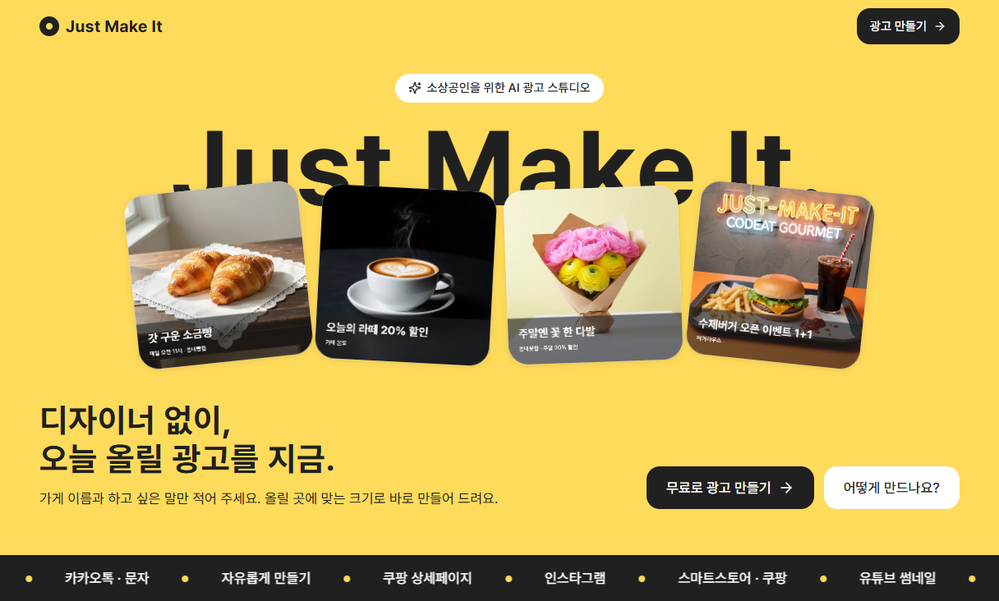
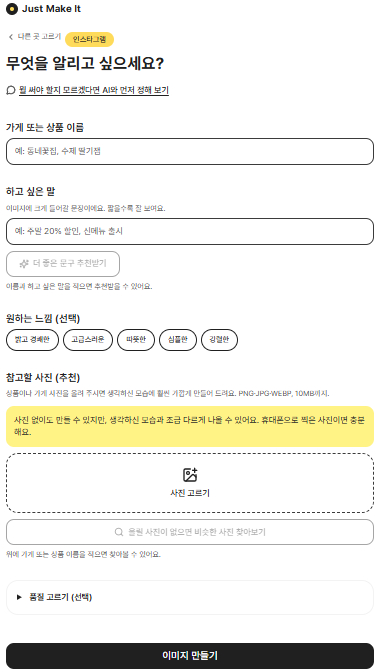
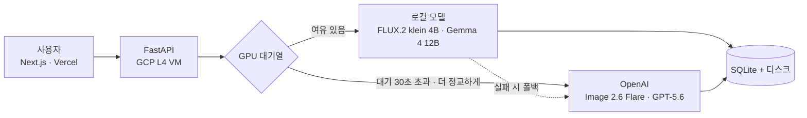

<div align="center">

# 🍩 JUST MAKE IT

### 디자이너 없이, 오늘 올릴 광고를 지금.

**소상공인을 위한 하이브리드 AI 광고 이미지·문구 생성 서비스**

[](https://just-make-it-ten.vercel.app)


</div>

---

## 📌 프로젝트 소개

소상공인이 웹에서 **상품, 하고 싶은 말, 올릴 곳** 세 가지만 넣으면 광고 이미지와 문구를 바로 받는 서비스입니다.

평소에는 GCP L4 GPU 한 장에 올린 **로컬 모델로 비용 없이** 만들고, GPU가 밀리거나 "더 정교하게"를 고르면 **OpenAI로 넘겨** 서비스가 끊기지 않게 했습니다.

| 🎯 문제 | 💡 해결 |
|---|---|
| 생성형 AI가 소금빵 같은 한국 품목을 모름 | 품목 사전과 참고 사진으로 생김새를 알려 줌 |
| 이미지 모델이 한글을 깨뜨림 | 이미지에는 글자를 그리지 않고, 문구는 서버와 웹 캔버스가 따로 얹음 |
| AI가 내 상품을 다른 모양으로 다시 그림 | 상품 사진은 그대로 두고 배경 장면만 생성 (`keep_product`) |
| API 비용이 장당 계속 나감 | 로컬 모델 우선, 하루 OpenAI 금액 상한으로 비용 관리 |

---

## 👀 서비스 미리보기

**🏠 메인 화면**

실제로 만든 광고 예시와 함께, 카카오톡, 쿠팡, 인스타그램, 유튜브 등 올릴 곳을 고르고 바로 시작합니다.

<p align="center"></p>

**🖼️ 광고 만들기**

가게 이름과 하고 싶은 말, 원하는 느낌을 넣고 참고 사진을 고르면 광고가 만들어집니다.

<p align="center"></p>

---

## 🏗️ 핵심 아키텍처

목표는 **비용 최적화**와 **끊기지 않는 서비스**를 함께 잡는 것입니다.



| 라우팅 | 이미지 | 문구 |
|---|---|---|
| ⚡ 기본 (로컬 L4 GPU, 비용 0원) | FLUX.2 klein 4B | Gemma 4 12B |
| ✨ 고품질 선택 (OpenAI) | gpt-image-2.6-flare | gpt-5.6-luna |
| 🧭 상담 기획서, 광고 조언 | | gpt-5.6-terra |

- **폴백:** 로컬 모델이 실패하거나 대기가 30초를 넘으면 OpenAI로 넘깁니다. klein이 모르는 품목은 처음부터 flare로 만듭니다.
- **비용 상한:** OpenAI는 하루 $3까지만 쓰고, 넘으면 로컬 모델로만 처리합니다.

**🖥️ 운영 환경:** GCP `g2-standard-4` (NVIDIA L4 24GB VRAM, 시스템 RAM 16GB) 한 대에서 돌아가도록 설계했습니다.

- klein 본체를 **FP8**로 불러오고 텍스트 인코더를 **8비트 양자화**해, klein과 Gemma를 GPU 한 장에 함께 올렸습니다 (실측 약 16.4GB).
- 추론 후 VRAM 캐시를 정리하고, 단일 워커(`--workers 1`)와 자체 대기열로 GPU 작업 수를 제한합니다.
- 서버가 켜질 때 웜업으로 첫 사용자 대기를 없앴습니다.

---

## 🧰 기술 스택

| 영역 | 사용 기술 |
|------|-----------|
| 🎨 프론트엔드 | Next.js 15, React 19, TypeScript, Tailwind CSS, transformers.js (브라우저 배경 지우기) |
| ⚙️ 백엔드 | Python 3.11, FastAPI, Pydantic, uv, SQLite |
| 🧠 모델 | FLUX.2 klein 4B (Diffusers, FP8), Gemma 4 12B (Ollama), bitsandbytes, OpenAI gpt-image-2.6-flare · GPT-5.6 Luna · Terra |
| 📏 평가 | CLIP, EasyOCR, pytest |
| ☁️ 인프라 | Docker (멀티스테이지), Docker Compose, GitHub Actions, GCP Compute Engine (L4), Vercel |

---

## ✨ 주요 기능

| 기능 | 설명 |
|------|------|
| 💬 AI 광고 상담 | 몇 가지 질문에 답하면 광고 기획서(목표, 채널, 문구, 분위기)를 만들어 바로 만들기로 이어짐. 자유 질문용 조언 대화도 있음 |
| ✍️ 문구 추천 | 상품 이름과 하고 싶은 말로 광고 문구 3개 추천. 할인율과 가격은 입력값 그대로 |
| 🖼️ 광고 이미지 생성 | 채널(인스타그램, 스마트스토어, 유튜브, 카카오톡)에 맞는 크기로 생성하고, 서버가 문구를 분위기에 맞게 얹음. 기다리는 동안 진행 막대와 정보 카드 |
| 📦 내 상품 그대로 | 상품 사진은 픽셀 그대로 두고 배경 장면만 AI로 (`keep_product`) |
| 🔁 다시 만들기, 조금 수정하기 | 더 밝게, 배경 단순하게, 텍스트 짧게, 품질 선택. 같은 원본에서 만든 결과를 나란히 비교 |
| 🖌️ AI로 꾸미기 | 만든 이미지의 글자만 flare가 장면에 어울리게 다시 그림 |
| ✂️ 직접 고치기 | 글자(단어별 글꼴, 색, 크기, 위치), 배경 지우고 색 채우기, 가게 QR(테두리, 점 모양, 가운데 로고). 고친 그림은 링크에도 저장 |
| 📋 게시 문구 키트 | 인스타 본문, 해시태그, 스토리, 네이버 쿠폰, 블로그 제목 등 채널별 글로 변환 |
| 🛍️ 상세페이지 | 커머스용 5개 섹션(대표, 특징, 마무리)의 문구와 이미지 |

---

## 👥 팀원 역할 및 작업 영역

<div align="center">

<table>
  <tr>
    <td align="center" width="160"></td>
    <td align="center" width="160"></td>
    <td align="center" width="160"></td>
  </tr>
  <tr>
    <td align="center"><b>최중열</b></td>
    <td align="center"><b>안찬형</b></td>
    <td align="center"><b>장한빈</b></td>
  </tr>
  <tr>
    <td align="center"></td>
    <td align="center"></td>
    <td align="center"></td>
  </tr>
</table>

</div>

프로젝트 코드는 각 담당자의 역할에 따라 `src/just_make_it/` 하위 폴더로 나눠 관리합니다.

### 📋 PM · 서비스 개발: 최중열 (Project Manager · Fullstack) [Notion 작업일지](https://app.notion.com/p/3fac4fa90261807fae50c8ebc774a030)
*   **담당 영역:** `README.md`, `docs/`, `CLAUDE.md` (기획안 및 API 스펙 관리), `src/just_make_it/service/`, `frontend/`
*   **핵심 미션:** 제품 스펙 정의, 기능 요구사항 구체화, API 엔드포인트 명세 조율. 비즈니스 로직 구현, 프리미엄 모드 판별, 생성 기록(SQLite)과 이미지를 VM 디스크에 저장하고 영구 URL 발급, 웹 화면과 브라우저 편집 기능 구현.

### 🧠 모델 개발: 안찬형 (Model Engineer) [Notion 작업일지](https://app.notion.com/p/3fe0c998e37f80b58e1af6165cba6c1a?pvs=25)
*   **담당 영역:** `src/just_make_it/core/`
*   **핵심 미션:** 텍스트, 이미지 모델 후보를 같은 조건에서 비교해 FLUX.2 klein 4B와 Gemma 4 12B 선정. RAM 16GB, VRAM 24GB 환경에 맞춰 klein 본체 FP8 로딩과 텍스트 인코더 8비트 양자화로 두 모델을 GPU 한 장에 탑재. 품목 사전과 참고 사진으로 한국 품목 생성 품질 개선, 로컬 실패 시 API 폴백 파이프라인, 웜업, CLIP과 OCR 정량평가 도구 구현.

### 🌐 서빙 엔지니어: 장한빈 (Serving Engineer) [Notion 작업일지](https://app.notion.com/p/3fb03a6fc0d280df8873f294a0df02cc?source=copy_link)
*   **담당 영역:** `src/just_make_it/serving/`, `Dockerfile`, `docker-compose.yml`
*   **핵심 미션:** FastAPI 기반 인프라 구축, **동시성 제어를 위한 단일 워커(--workers 1)** 세팅, 로컬 GPU 상태 모니터링을 통한 OpenAI 비동기 분기 로직(`queue_manager.py`) 구현, 제한 시간과 하루 금액 상한 관리, 컨테이너 환경 관리.

---

## 🍩 시연 페이지

프로젝트 기간(~2026.11.15)에만 일시적으로 운영되는 페이지입니다.

👉 [JUST-MAKE-IT Web UI](https://just-make-it-ten.vercel.app)

---

## 📈 팀 프로젝트 보고서

👉🏼 <a href="https://drive.google.com/file/d/1lyKs7oK8rUc03kvDeGjURxBh7PUgDg7s/view?usp=sharing">
     보고서
   </a>

---

## 📚 문서

| 구분 | 문서 | 내용 |
|------|------|------|
| 기획 | [`docs/api_spec.md`](docs/api_spec.md) | API 명세 (엔드포인트, 요청, 응답, 미결 사항) |
| | [`docs/product/user_flow.md`](docs/product/user_flow.md) | 유저 플로우 |
| | [`docs/product/model_selection.md`](docs/product/model_selection.md) | 모델 선택 근거 |
| | [`docs/product/pipeline_options.md`](docs/product/pipeline_options.md) | 생성 파이프라인 구성안 |
| | [`docs/product/korean_item_validation.md`](docs/product/korean_item_validation.md) | 한국 품목 이미지 검증 계획 |
| 모델 | [`src/just_make_it/core/README.md`](src/just_make_it/core/README.md) | 모델 파트 구조, 폴백, GPU 최적화, 설정값 |
| | [`src/just_make_it/core/evaluation/README.md`](src/just_make_it/core/evaluation/README.md) | 정량평가 실행 방법과 점수 |
| 서빙 | [`src/just_make_it/serving/README.md`](src/just_make_it/serving/README.md) | 엔드포인트, 생성 경로, 운영 장치 |
| | [`docs/serving/docker_build.md`](docs/serving/docker_build.md) | Docker 이미지 크기와 배포 시간 정리 |
| 서비스 | [`src/just_make_it/service/README.md`](src/just_make_it/service/README.md) | 서비스 층 (BE, FE) 정리 |
| | [`frontend/README.md`](frontend/README.md) | 프론트엔드 상세 |
| 협업 | [`docs/CONTRIBUTING.md`](docs/CONTRIBUTING.md) | 브랜치, 리뷰, 담당 영역 규칙 |
| | [`CLAUDE.md`](CLAUDE.md) | AI 코딩 에이전트용 규칙 (하드 제약, 담당 영역) |

---

## 🛠️ 개발 환경 설정

본 프로젝트는 `uv`와 **Docker**를 함께 사용합니다.

### 1. 전제 조건
*   `uv` 설치: `curl -LsSf https://astral.sh/uv/install.sh | sh`
*   Docker + Docker Compose
*   (GPU 사용 시) [NVIDIA Container Toolkit](https://docs.nvidia.com/datacenter/cloud-native/container-toolkit/install-guide.html)

### 2. 프로젝트 초기화
```bash
git clone git@github.com:sprint-ai-12-4team/just-make-it.git
cd just-make-it
uv sync                # 서빙, 프론트 개발용
uv sync --extra gpu    # 로컬 모델까지 돌릴 때 (torch, diffusers 등)
```

### 3. 환경 변수 설정 (`.env`)
```bash
cp .env.example .env   # 값 채우기. Git에 커밋 금지
```
- 필수는 `OPENAI_API_KEY`. 나머지(한도, 예산, 백엔드 등)는 `.env.example`의 설명과 기본값 참고
- GPU 없이 화면과 API만 볼 때는 `IMAGE_BACKEND=mock`

### 4. 실행 방법

#### A. Docker Compose (권장, 프로덕션과 같은 환경)
```bash
docker compose up --build      # 빌드 + 실행 (GPU 포함)
docker compose up -d           # 백그라운드 실행
docker compose logs -f api     # 로그 확인
docker compose down            # 중지
```
- 모델 가중치는 이미지에 포함되지 않고 `model-cache` 볼륨에 캐시됩니다.
- 코드를 바꾸면 `--build`로 다시 빌드합니다.

#### B. 호스트에서 직접 실행 (모델 빠른 실험용)
```bash
uv run uvicorn just_make_it.serving.main:app --host 0.0.0.0 --port 8000 --workers 1
```
- CUDA가 호스트에 설치되어 있어야 로컬 모델을 사용할 수 있습니다.
- GPU가 없으면 `IMAGE_BACKEND=mock`으로 띄웁니다 (OpenAI 호출 없음).

### 5. 프론트엔드 (Next.js)
```bash
cd frontend
cp .env.example .env.local
npm install
npm run dev
```
- 브라우저: http://localhost:3000
- 백엔드 API 주소는 `.env.local`의 `NEXT_PUBLIC_API_URL` (기본 `http://localhost:8000`). 서버 없이 화면만 볼 때는 `NEXT_PUBLIC_MOCK=1`
- 상세: [`frontend/README.md`](frontend/README.md)

### 6. 테스트
```bash
uv run pytest tests/ -v
```
- 테스트에서 실제 OpenAI API를 부르지 않습니다 (팀 한도 $30).
- 모델은 가짜 객체로 바꿔 끼워, GPU나 API 키 없이 실행됩니다.

---

## 🚀 CI/CD 및 배포

`main`, `dev` 브랜치에 push(PR 머지 포함)하면 GitHub Actions(`.github/workflows/cd.yml`)가 GCP L4 인스턴스에 자동 배포합니다. 프론트엔드는 Vercel에 배포됩니다.

*   **배포 방식:** Docker 멀티스테이지 빌드 기반 컨테이너 배포
*   **실행 옵션:** RAM 16GB에 맞춰 `--workers 1`, GPU를 할당한 컨테이너 하나로 구동합니다. 모델 로드 순간의 메모리 급증은 VM의 Swap(32GB)으로 흡수합니다.
*   **모델 가중치:** 이미지에 포함하지 않고, 시작 시 캐시와 볼륨에서 불러옵니다.

---

## 🤝 협업 방식

3인 팀이 역할별 폴더를 나눠 맡고, `feature/*`에서 작업한 뒤 `dev`(통합, 배포)를 거쳐 `main`으로 PR 리뷰 후 머지했습니다. 자세한 규칙은 [`docs/CONTRIBUTING.md`](docs/CONTRIBUTING.md)를 참고하세요.

---

## 🗂️ 디렉토리

```
📦 just-make-it
┣ 📂 .github/workflows
┃ ┗ 📄 cd.yml                # VM 자동 배포
┣ 📂 docs                    # [PM] API 명세, 제품 문서, 서빙 문서, README 이미지(imgs)
┣ 📂 frontend                # [서비스] Next.js 15 (app, components, lib)
┣ 📂 src/just_make_it
┃ ┣ 📂 core                  # [모델] 모델 로드, 추론, 프롬프트, 문구, 글자 얹기
┃ ┃ ┗ 📂 evaluation          # [모델] 정량평가 (CLIP, OCR)
┃ ┣ 📂 serving               # [서빙] FastAPI 라우터, 대기열, 폴백, 기록
┃ ┣ 📂 service               # [서비스] DB(SQLite), 이미지 저장, 대기 카드
┃ ┗ 📄 config.py             # 모델 이름, 설정값
┣ 📂 tests                   # pytest
┣ 📄 Dockerfile              # 멀티스테이지 빌드
┣ 📄 docker-compose.yml      # 전체 스택 (GPU)
┣ 📄 pyproject.toml          # uv 의존성 (gpu, eval 묶음)
┣ 📄 uv.lock
┣ 📄 .env.example            # 환경 변수 목록
┣ 📝 CLAUDE.md               # AI 코딩 에이전트용 규칙
┣ 📝 LICENSE
┗ 📝 README.md
```

---

## 📄 라이선스

이 저장소의 코드는 [MIT License](LICENSE)를 따릅니다. 아래는 각자의 라이선스를 따르며 MIT 적용 대상이 아닙니다.

- 모델 가중치 (저장소에 포함하지 않음): FLUX.2 klein 4B, Gemma 4 — 각 모델 카드의 라이선스 (둘 다 Apache 2.0)
- OpenAI API 출력: OpenAI 이용 약관
- 글꼴 (`core/assets/fonts`, `frontend/public/fonts`): 주아, 연성, 고운바탕, 고운돋움, 검은고딕 — SIL Open Font License 1.1
- 참고 사진 후보: Pixabay Content License
