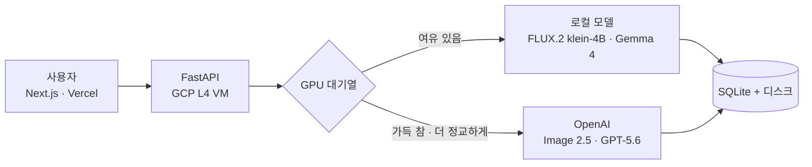

# JUST MAKE IT - AI 광고 이미지 생성 서비스
> **"Just Make It" 팀의 하이브리드 AI 이미지 생성 및 서빙 플랫폼 프로젝트입니다.**  
> 소상공인이 웹에서 광고 이미지·문구를 직접 만드는 서비스입니다. 평소에는 GCP L4 GPU의 로컬 모델로 비용 없이 만들고, GPU가 밀리거나 "더 정교하게"를 고르면 OpenAI로 넘깁니다.

---

## 프로젝트 개요 및 핵심 아키텍처

목표는 **비용 최적화**와 **끊기지 않는 서비스**를 함께 잡는 것입니다.



*   **기본 라우팅 (로컬 L4 GPU):** 일반적인 이미지 생성 요청은 자체 서빙 모델(FLUX.2 klein-4B)로 처리하여 비용을 `0원`으로 수렴시킵니다.
*   **우회 라우팅 (OpenAI Fallback):** 로컬 GPU 대기 큐(Queue)가 가득 차거나 프리미엄 기능을 요청할 경우, `OpenAI Image 2.5 API`로 요청을 즉시 우회하여 유저 대기 시간을 최소화합니다.
*   **문구:** 로컬 Gemma 4 12B, "더 자연스럽게"를 고르면 OpenAI GPT-5.6 Luna.

**개발·운영 환경:** GCP `g2-standard-4` (NVIDIA L4 24GB VRAM, 시스템 RAM 16GB) 한 대에서 돌아가도록 설계했습니다. 작은 RAM에 맞춰 FP16 추론, 추론 후 VRAM 캐시 정리, 단일 워커(`--workers 1`) + 자체 대기열로 GPU 작업 수를 제한하고, OpenAI 비용은 일일 예산 상한으로 막습니다.

---

## 기술 스택

| 영역 | 사용 기술 |
|------|-----------|
| 프론트엔드 | Next.js 15, React 19, TypeScript, Tailwind CSS, transformers.js(브라우저 배경 지우기) |
| 백엔드 | Python 3.11, FastAPI, Pydantic, uv, SQLite |
| 모델 | FLUX.2 klein-4B(diffusers), Gemma 4 12B, OpenAI Image 2.5 Flare · GPT-5.6 Luna |
| 인프라 | Docker(멀티스테이지), Docker Compose, GitHub Actions, GCP Compute Engine(L4), Vercel |

---

## 주요 기능

| 기능 | 설명 |
|------|------|
| AI 광고 상담 | 몇 가지 질문에 답하면 광고 기획서(목표·채널·문구·분위기)를 만들어 바로 만들기로 이어짐. 자유 질문용 조언 대화도 있음 |
| 문구 추천 | 상품 이름·하고 싶은 말로 광고 문구 3개 추천. 할인율·가격은 입력값 그대로 |
| 광고 이미지 생성 | 채널(인스타그램·스마트스토어·유튜브·카카오톡)에 맞는 크기로 생성, 서버가 문구를 분위기에 맞게 얹음. 기다리는 동안 진행 막대·정보 카드 |
| 내 상품 그대로 | 상품 사진은 픽셀 그대로 두고 배경 장면만 AI로 (`keep_product`) |
| 다시 만들기·조금 수정하기 | 더 밝게·배경 단순하게·텍스트 짧게, 품질 선택. 같은 원본에서 만든 결과를 나란히 비교 |
| 직접 고치기 | 글자(단어별 글꼴·색·크기·위치), 배경 지우고 색 채우기, 가게 QR(테두리·점 모양·가운데 로고). 고친 그림은 링크에도 저장 |
| 게시 문구 키트 | 인스타 본문·해시태그·스토리, 네이버 쿠폰·블로그 제목 등 채널별 글로 변환 |
| 상세페이지 | 커머스용 5개 섹션(대표·특징·마무리)의 문구와 이미지 |

---

## 팀원 역할 및 작업 영역 (Role & Responsibilities)

프로젝트 코드는 각 담당자의 역할에 따라 `src/just_make_it/` 하위 폴더로 격리되어 관리됩니다.

### 1. 📋 PM: 최중열 (Project Manager) [Notion 작업일지](https://app.notion.com/p/3fac4fa90261807fae50c8ebc774a030)
*   **담당 영역:** `README.md`, `docs/`, `CLAUDE.md` (기획안 및 API 스펙 관리)
*   **핵심 미션:** 제품 스펙 정의, 기능 요구사항 구체화, API 엔드포인트 명세 조율.

### 2. 🧠 모델 개발: 안찬형 (Model Engineer) [Notion 작업일지](https://app.notion.com/p/3fe0c998e37f80b58e1af6165cba6c1a?pvs=25)
*   **담당 영역:** `src/just_make_it/core/`
*   **핵심 미션:** RAM 16GB/VRAM 24GB 환경에서 구동 가능한 경량/가속 이미지 생성 파이프라인(FLUX.2 klein-4B, gemma4-12B-it) 구축, FP16 양자화 및 VRAM 캐시 최적화, 프롬프트 finetuning으로 사용자 요청에 근접한 이미지 생성.

### 3. 🌐 서빙 엔지니어: 장한빈 (Serving Engineer) [Notion 작업일지](https://app.notion.com/p/3fb03a6fc0d280df8873f294a0df02cc?source=copy_link)
*   **담당 영역:** `src/just_make_it/serving/`, `Dockerfile`, `docker-compose.yml`
*   **핵심 미션:** FastAPI 기반 인프라 구축, **동시성 제어를 위한 단일 워커(--workers 1)** 세팅, 로컬 GPU 상태 모니터링을 통한 OpenAI 비동기 분기 로직(`queue_manager.py`) 구현, 컨테이너 환경 관리.

### 4. 🛠️ 서비스 개발: 최중열 (Fullstack Developer)
*   **담당 영역:** `src/just_make_it/service/`
*   **핵심 미션:** 비즈니스 로직 구현, 프리미엄 모드 판별, 생성 기록(SQLite)과 이미지를 VM 로컬 디스크에 저장하고 영구 URL 발급.

---

## 시연 페이지

프로젝트 기간에만 일시적으로 운영되는 페이지입니다. 아래 링크를 따라가세요.

[🍩 JUST-MAKE-IT Web UI](https://just-make-it-ten.vercel.app)

---

## 문서

| 문서 | 내용 |
|------|------|
| [`docs/api_spec.md`](docs/api_spec.md) | API 명세 (엔드포인트·요청·응답·미결 사항) |
| [`docs/product/user_flow.md`](docs/product/user_flow.md) | 유저 플로우 |
| [`docs/product/model_selection.md`](docs/product/model_selection.md) | 모델 선택 근거 |
| [`frontend/README.md`](frontend/README.md) | 프론트엔드 상세 |
| [`docs/CONTRIBUTING.md`](docs/CONTRIBUTING.md) | 브랜치·리뷰·담당 영역 규칙 |
| [`CLAUDE.md`](CLAUDE.md) | AI 코딩 에이전트용 규칙 (하드 제약·담당 영역) |

---

## 🛠️ 개발 환경 설정 (Local Setup)

본 프로젝트는 `uv`와 **Docker**를 함께 사용합니다.

### 1. 전제 조건
*   `uv` 설치: `curl -LsSf https://astral.sh/uv/install.sh | sh`
*   Docker + Docker Compose
*   (GPU 사용 시) [NVIDIA Container Toolkit](https://docs.nvidia.com/datacenter/cloud-native/container-toolkit/install-guide.html)

### 2. 프로젝트 초기화
```bash
git clone git@github.com:sprint-ai-12-4team/just-make-it.git
cd just-make-it
uv sync
```

### 3. 환경 변수 설정 (`.env`)
```bash
cp .env.example .env   # 값 채우기. Git에 커밋 금지
```
- 필수는 `OPENAI_API_KEY`. 나머지(한도·예산·백엔드 등)는 `.env.example`의 설명과 기본값 참고
- GPU 없이 화면·API만 볼 때는 `IMAGE_BACKEND=mock`

### 4. 실행 방법 (두 가지)

#### A. Docker Compose (권장 — 프로덕션과 동일한 환경)
```bash
# 빌드 + 실행 (GPU 포함)
docker compose up --build

# 백그라운드 실행
docker compose up -d

# 로그 확인
docker compose logs -f api

# 중지
docker compose down
```
- 모델 가중치는 이미지에 포함되지 않습니다. `model-cache` 볼륨에 캐시됩니다.
- 코드를 바꾸면 `--build`로 다시 빌드합니다.

#### B. 호스트에서 직접 실행 (모델 빠른 실험용)
```bash
uv run uvicorn just_make_it.serving.main:app --host 0.0.0.0 --port 8000 --workers 1
```
- CUDA가 호스트에 설치되어 있어야 로컬 모델을 사용할 수 있습니다.
- GPU가 없으면 `IMAGE_BACKEND=mock`으로 띄웁니다 (OpenAI 호출 없음).

### 5. 프론트엔드 (Next.js)
```bash
cd frontend
cp .env.example .env.local
npm install
npm run dev
```
- 브라우저: http://localhost:3000
- 백엔드 API 주소는 `.env.local`의 `NEXT_PUBLIC_API_URL` (기본 `http://localhost:8000`). 서버 없이 화면만 볼 때는 `NEXT_PUBLIC_MOCK=1`
- 상세: `frontend/README.md`

### 6. 테스트
```bash
uv run pytest tests/ -v
```
- 테스트에서 실제 OpenAI API를 부르지 않습니다 (팀 한도 $30).

---

## 🚀 CI/CD 및 배포 파이프라인

`main`·`dev` 브랜치에 push(PR 머지 포함)하면 GitHub Actions(`.github/workflows/cd.yml`)가 GCP L4 인스턴스에 자동 배포합니다. 프론트엔드는 Vercel에 배포됩니다.

*   **배포 방식:** Docker 멀티 스테이지 빌드 기반 컨테이너 배포
*   **실행 옵션:** RAM 16GB에 맞춰 `--workers 1`, GPU를 할당한 컨테이너 하나로 구동합니다. 모델 로드 순간의 메모리 급증은 VM의 Swap(32GB)으로 흡수합니다.
*   **모델 가중치:** 이미지에 포함하지 않고, 시작 시 캐시/볼륨에서 로드합니다.

---

## 🤝 협업 방식

4인 팀이 역할별 폴더를 나눠 맡고, `feature/*` → `dev`(통합·배포) → `main` 흐름으로 PR 리뷰 후 머지했습니다. 자세한 규칙: [`docs/CONTRIBUTING.md`](docs/CONTRIBUTING.md)

---

## 디렉토리
```bash
just-make-it/
├── .github/workflows/cd.yml     # VM 자동 배포
├── Dockerfile                   # 멀티스테이지 빌드
├── docker-compose.yml           # 전체 스택 (GPU)
├── pyproject.toml, uv.lock      # uv 의존성
├── .env.example                 # 환경 변수 목록
├── CLAUDE.md                    # AI 코딩 에이전트용 규칙
├── docs/                        # [PM] API 명세, 제품 문서
├── frontend/                    # [서비스] Next.js 15 (app·components·lib)
├── src/just_make_it/
│   ├── core/                    # [모델] 모델 로드·추론, 프롬프트, 문구, 글자 얹기, 평가(evaluation/)
│   ├── serving/                 # [서빙] FastAPI 라우터, 대기열·Fallback(queue_manager.py), 기록
│   └── service/                 # [서비스] DB(SQLite)·이미지 저장, 대기 카드
└── tests/                       # pytest
```

---

## 라이선스

이 저장소의 코드는 [MIT License](LICENSE)를 따릅니다. 아래는 각자의 라이선스를 따르며 MIT 적용 대상이 아닙니다.

- 모델 가중치 (저장소에 포함하지 않음): FLUX.2 klein-4B, Gemma 4 — 각 모델 카드의 라이선스
- OpenAI API 출력: OpenAI 이용 약관
- 글꼴 (`core/assets/fonts`, `frontend/public/fonts`): 주아·연성·고운바탕·고운돋움·검은고딕 — SIL Open Font License 1.1
- 참고 사진 후보: Pixabay Content License
